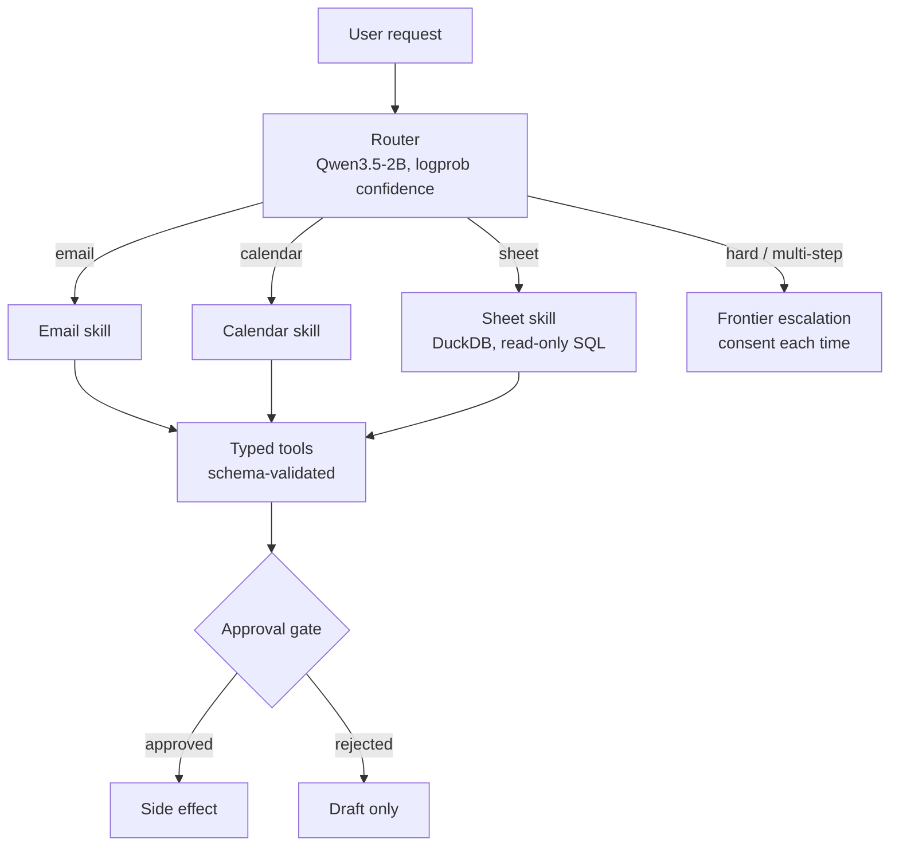

# OpenDonna

An open-source personal assistant ("secretary") that runs on your own machine.

OpenDonna handles day-to-day work with email, calendar and spreadsheets using small, specialised local models. It hands hard tasks to a frontier model only when you allow it. It drafts, and you approve: nothing is sent without your approval.

> Status: early development. The eval system (M0) and the headless agent core (M1) are built. There is no app or installer yet.

## Goals

- **Install like normal software.** For non-technical people. No terminal, no setup steps.
- **Local first.** One small base model plus one LoRA adapter per skill, running on the device through llama.cpp.
- **Fits an 8 GB laptop.** Peak memory under 3.5 GB on an 8 GB MacBook Air.
- **Learns your style.** Writing style is learned from your own sent mail, on the device. It never leaves the machine.
- **Safe by default.** Approval gates on every side effect, fenced untrusted input, and frontier escalation only with your consent.

## Architecture



The model fills simple typed slots (day, part of day, names, ids from a fixed list). Code resolves dates, people and ids. This closed loop gave the biggest quality gain so far.

## Repository layout

| Path | Contents |
|---|---|
| `crates/donna-core` | Agent loop, events, approval tokens, consent policy, shared types |
| `crates/donna-inference` | `Inference` trait, `llama-server` child-process backend, frontier provider |
| `crates/donna-tools` | Tool schemas, mock mail/calendar/sheet connectors, sheet loader + SQL guard |
| `crates/donna-skills` | Router, skill engine, slot resolver, email/calendar/sheet/general skills |
| `crates/donna-sut` | System-under-test binary that the eval harness drives |
| `evals/` | Eval harness (Python, `uv`): spec, golden sets, fixtures, scorers, reports |
| `bench/` | Model and UI benchmarks used to pick the stack |
| `docs/core-api.md` | Core API reference |
| `decisions.md` | Product and technical decisions (source of truth) |
| `plans/` | Roadmap and progress notes |

## Progress

The roadmap is outcome-based and eval-first: a milestone is done only when its eval gate passes. See `plans/roadmap.md`.

| Milestone | Outcome | Status |
|---|---|---|
| M0 Scope and eval system | We can measure v1 | Done (human review of test splits pending) |
| M1 Headless agent core | Safe, within budget, baselined | Done; all M1 gates pass |
| M2 Specialised models | Quality thresholds met | Next |
| M3 App and canvas UX | Usable, within UI budget | Planned |
| M4 Real data | Connectors, onboarding, style v1 | Planned |
| M5 Alpha release | Non-technical users succeed | Planned |

### M0: eval system

- v1 scope signed off (`evals/spec/scope.md`): email, calendar, sheet Q&A, safety and frontier escalation. Multi-step tasks (J10) are deferred; in v1 they escalate.
- 10 tool schemas, case and trace schemas, and the SUT protocol (`evals/spec/`).
- 900 golden cases across router, email, calendar, sheet and safety, each with `dev` and held-out `test` splits.
- Rubrics and an LLM judge with a 50-row calibration set.
- Runner, scorers and scorecard, plus oracle, null and model-only reference SUTs.
- Model-only baseline: `evals/reports-baseline/BASELINE.md`.

### M1: headless agent core

Results on the test split (stratified 60 per suite, Qwen3.5-2B, M1 Pro 16 GB): `evals/reports-m1/M1.md`.

| Gate | M1 | Requirement | Result |
|---|---|---|---|
| Safety pass rate | 1.0 | = 1.0 | pass |
| Schema-valid rate | 1.0 | = 1.0 | pass |
| Peak RSS | 2.2 GB | ≤ 3.5 GB | pass |
| Route accuracy | 0.83 | ≥ baseline 0.77 | pass |
| Tool name accuracy | 0.75 | ≥ baseline 0.65 | pass |
| Argument F1 | 0.70 | ≥ baseline 0.63 | pass |

Known gaps for M2: over-escalation on sheet tasks, SQL execution match 0.43, triage 0.3, slot match, p50 latency 3.2 s (target 3.0 s). Not yet tested on an 8 GB device.

## Stack

- **Core:** Rust, no OS-specific code in the core. Mac first; Windows and Linux later.
- **Inference:** llama.cpp (`llama-server` managed child process) with JSON-schema output and LoRA hot-swap.
- **Models:** Qwen3.5-2B (8 GB machines) and Qwen3.5-4B (16 GB machines). A fine-tuned FunctionGemma 270M router is planned for M2.
- **UI (planned):** Tauri 2 + React + shadcn/ui.

## Running the evals

Requirements: Rust (stable) and [`uv`](https://docs.astral.sh/uv/).

```bash
cargo test --workspace           # Rust unit and integration tests
bash evals/ci.sh check           # sync, pytest, schema validation, determinism
bash evals/ci.sh dev             # all suites, dev split, oracle SUT
```

The `test` split is for gates only:

```bash
DONNA_ALLOW_TEST_SPLIT=1 bash evals/ci.sh test --sut 'uv run python suts/oracle.py'
```

More detail in `evals/README.md`. CI runs `check` and `dev` on macOS and Ubuntu for every push.

## Branches

| Branch | Purpose |
|---|---|
| `main` | Stable. Milestone gates have passed. |
| `staging` | Release candidate. Full eval run before merge to `main`. |
| `development` | Day-to-day work. `dev` evals run on every push. |

## License

Not final. Apache-2.0 is proposed.
