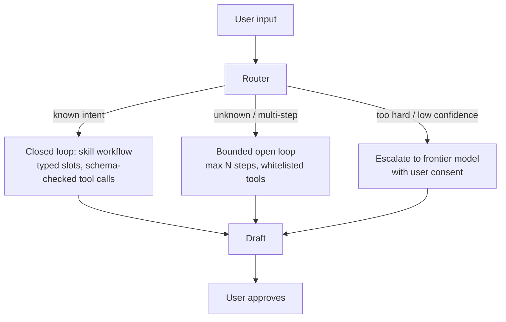

# Personal Assistant — Decisions

Last updated: 2026-11-20. Build against this file. Change it before changing direction.

## Product

- Open-source personal assistant ("secretary") that runs on the user's machine.
- Target users: non-technical people. Install like normal software. No terminal, no setup steps.
- Does day-to-day tasks: email, calendar, spreadsheets, and hands hard tasks to a frontier model.
- Learns the user's writing style and personality from their own data, on the device.
- Safe by default: the assistant drafts, the user approves. Nothing is sent without approval.

## Market gap (research 2026-11-20)

- OpenClaw: strong agent features, but technical setup (Node, npm, terminal) and needs a frontier model. No style learning.
- Local Code (Draw Things team, Oct 2026): closest competitor. Easy local Mac app, but not a secretary and no style learning.
- TypeTab / Typeahead: show that on-device style fine-tuning works, but only do writing.
- Our position: one-click install + small specialised local models + style learning + frontier escalation + approval gates.

## Platform and app

- Language: Rust.
- Mac first. Windows and Linux later from the same codebase.
- Rust core has no OS-specific code. OS-specific connectors (EventKit, Apple Mail) go behind adapters.
- Ship cross-platform connectors first: Gmail, Google Calendar, Outlook.
- Must be snappy and stay within a strict memory and CPU budget.
- **Decided (2026-11-20): UI stack = Tauri 2 + React + shadcn/ui.** Rust core, web UI. Components: Radix Popover, react-day-picker (date), cmdk (multi-select), TanStack Table + Virtual (tables). Chosen over GPUI because it gives a canvas out of the box; the measured RAM cost (+121 MiB idle) is ~5% of the 8 GB-tier total. Electron rejected (memory).
- Proposed canvas library: Excalidraw (MIT). tldraw needs a paid production licence. Canvas RAM not measured yet.
- Proposed inference: llama.cpp through Rust bindings (`llama-cpp-2`), Metal on Mac, with LoRA hot-swap.

## Resource budget (target: 8 GB MacBook Air)

- App shell: < 250 MB idle (Tauri measured 205 MiB incl. WebKit helpers), ~0% CPU idle.
- Router model: always loaded, < 600 MB.
- Base model: load on demand, unload after ~5 min idle.
- Peak: < 3.5 GB on 8 GB machines, < 5 GB on 16 GB machines.

## Models

- Small models, each specialised to do one small set of jobs very well.
- Approach: one base model + one small LoRA adapter per skill (not many full models).
- **Decided (2026-11-20): base model = Qwen3.5.** Qwen3.5-2B on 8 GB machines, Qwen3.5-4B on 16 GB machines. Same family, shared training pipeline; each skill adapter is trained once per size. Backup: Gemma 4 E2B. Dropped: Gemma 4 E4B (4.04 GB, over budget), Phi-4-mini (no native tool calls via llama.cpp).
- **Decided (2026-11-20): router = FunctionGemma 270M, fine-tuned** (0.46 GB, the only router that fits < 600 MB). Untuned it scored 0.13, so it must be fine-tuned. Fallback if it misses the target: the base model does the routing itself.
- 8 GB total: Qwen3.5-2B 1.70 GB + router 0.46 GB + UI 0.21 GB ≈ 2.37 GB (< 3.5 GB).
- Re-benchmark newer Qwen small models (3.6 / 3.8) when GGUFs ≤ 4B are published.
- v1 skill adapters: `router`, `email`, `calendar`, `sheet-qa`, `style` (per user, trained on device).

## Training data

- Tool calling: Salesforce xLAM-60k, Glaive function calling, plus synthetic data from our own tool schemas.
- Email: Enron corpus plus synthetic threads.
- Sheets: synthetic tables with code-verified answers.
- Teacher model for synthetic data: a large open model (for example Qwen 235B). Do not train on Claude/OpenAI outputs without checking their terms.
- Per-user style: from the user's sent mail, never leaves the device.

## Agent core: hybrid (not a closed loop, not fully open-ended)

- Closed loop: the model only fills slots; code runs the steps. Covers most daily requests.
- Bounded open loop: the model plans within step, tool and time limits.
- Escalate when: router confidence is low, the step budget runs out, or schema validation fails twice.

## Evals (4 layers)

1. Closed-loop golden sets: router label, slot extraction, tool name and arguments. Exact or structured match. Metrics: accuracy, argument F1, schema-valid rate.
2. Open-output rubrics: drafts, summaries, style match, plans. LLM judge with a 1–5 rubric per criterion plus pairwise comparison. Calibrate the judge against ~50 human-graded examples.
3. Trajectory evals: scripted multi-step scenarios on mock tools. Metrics: task success, steps used, wrong tool calls.
4. Safety, injection and performance: no send without approval, resists prompt injection inside emails, stays within RAM and latency limits. Safety must pass 100%. This layer blocks releases.

- Every golden example is labelled "local" or "should escalate", to measure both over- and under-escalation.

## Spreadsheet analysis

- The small model never does arithmetic on raw cells.
- Pipeline: profile the sheet in code (`calamine`) → small model writes SQL → DuckDB runs it → small model explains the result.
- The small model handles lookups, filters, totals, averages, group-by, top-N and simple charts.
- Escalate for: messy sheets (merged cells, several header rows), joins across sheets, "why" and forecasting questions, ambiguous questions.
- Frontier models: supported, with the user's own API key. Modes: Local only / Ask each time (default) / Auto.
- Privacy default: send only the sheet profile and query results, not raw rows. The user can allow sending the full sheet.
- Evals: execution match on text-to-SQL. Start from BIRD/Spider and WikiTableQuestions/TableBench, plus our own golden set of messy real sheets.

## UI

- Canvas-style workspace where users set up several tasks side by side.
- Proposed form: a board of cards (email, calendar, sheet, document), each with a ready-made layout, plus a chat bar that is always visible. No empty infinite canvas.
- "Draw and ask": the user lassos part of a card's output and asks about it. Selection passes structured data (cell ranges + values, email IDs), not pixels.
- Linux note: Tauri uses WebKitGTK there, so keep the canvas lightweight (canvas/WebGL, little DOM).

## Open questions

- Business model: fully free open source, or open core (paid hosted fine-tuning / sync)?
- First milestone: proposed = app shell + router + email card + calendar card, proving the speed and memory budget before training. Sheets and on-device style training in phase 2. Not confirmed yet.
- "Proposed" items above are the defaults until the user confirms or changes them.

## Name and open source (2026-11-20)

- **Decided: project name = OpenDonna.** Bare "Donna" is taken by at least 6 email/calendar AI assistants (heydonna.co, getdonna.co, donna.sh, donna.magiclabs.studio, textdonna.com, Donna AI Family Organizer) and the main handles/domains are taken.
- Checked free on 2026-11-20: GitHub `opendonna`, Hugging Face `opendonna`, crates.io `opendonna`, npm `opendonna`. Domains opendonna.dev / .org / .ai had no DNS (not confirmed at a registrar); opendonna.app is taken.
- User creates the GitHub and Hugging Face `opendonna` organisations (free) on 2026-11-20.
- **No money spent until the app is built and tested locally:** no domain, no Apple Developer account ($99/yr), no paid hosting yet.
- Do not reserve crates.io / npm names with placeholders (crates.io policy); publish real packages later.
- Branding: no Suits images, quotes or "Harvey" references (NBCUniversal).
- Before public launch: trademark search for "Donna" (USPTO, EUIPO; classes 9 and 42).
- Proposed: Apache-2.0 licence; private golden `test` split, public `dev` split. Open: DCO vs CLA (depends on the business model).
- Open-source checklist (later): LICENSE + NOTICE, README, CONTRIBUTING (evals gate PRs), CODE_OF_CONDUCT, SECURITY.md, THIRD_PARTY_LICENSES, issue/PR templates, `.gitignore` for models and user data, CI, roadmap tickets as GitHub Issues/Milestones, HF model cards. FunctionGemma uses the Gemma Terms of Use (not OSI); mention it or use the Qwen-only router fallback.

## Next step

- Roadmap approved 2026-11-20: `plans/roadmap.md` (M0 eval system → M5 alpha). Build later, starting with M0 tickets E-01 and E-02.

## Benchmark results (2026-11-20)

- Results page: https://claude.ai/artifact/3Ahqn4sLRYszzDUqq6xNte (raw data in `bench/results/`).
- Measured on M1 Pro 16 GB; 8 GB fit = peak RSS ≤ 3.5 GB.
- Fits budget: Qwen3.5 0.8B/2B/4B, Gemma 4 E2B, Phi-4-mini, FunctionGemma. Does not fit: Gemma 4 E4B (4.04 GB).
- UI: GPUI + gpui-kit 0.10.0 used ~84 MiB idle vs ~205 MiB for Tauri (app + WebKit helpers); both have library date picker, multi-select and virtualised table.
- Decisions taken from these results: Qwen3.5 base, fine-tuned FunctionGemma router, Tauri 2 + React + shadcn/ui (see Platform and Models).
