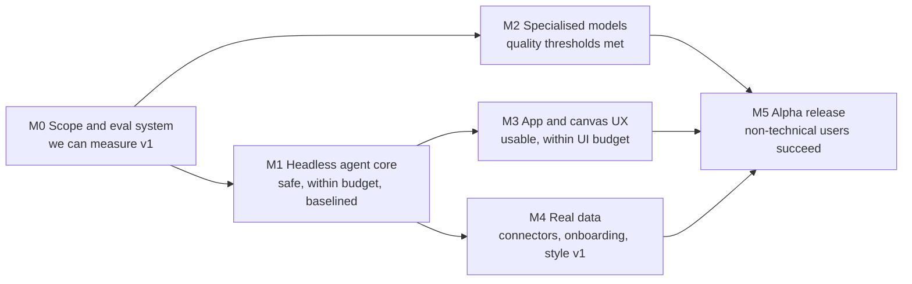
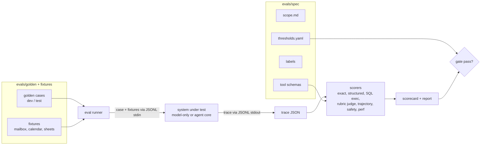
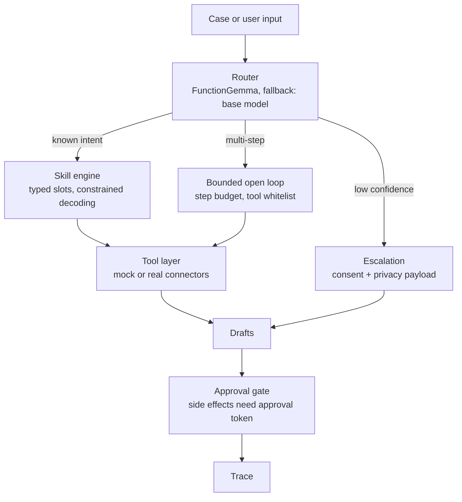

# Roadmap: outcome-based milestones (eval first)

Status: draft for review, 2026-11-20. Source of truth for decisions: `decisions.md`.

## How we work

- **Outcome first.** Each milestone is defined by a measurable outcome and a gate (eval thresholds), not by a feature list. A milestone is done only when its gate passes.
- **Evals before code.** M0 writes the eval system. The eval system *is* the scope: if a job is not in a golden set, it is not in v1.
- **Contracts decouple tickets.** Tool schemas, the trace format and the system-under-test (SUT) protocol are fixed first. After that, golden sets, the eval runner, the core, training and the UI can be built in parallel against those contracts.
- **Held-out test split.** Every golden set has a `dev` split (used while building) and a `test` split (used only at gates). The test split is never shown to training pipelines or prompt authors. Training data is deduplicated against it.
- **Every ticket names its metric.** A ticket says which eval metric it moves or protects. A change that regresses the scorecard by more than the allowed margin is not merged.
- **One ticket = one crew task** (planner → worker → reviewer). Specs with more than 10 items are split into batches.

## Milestone map



- M2 (training) depends on M0 data and contracts, not on M1 code. It can start as soon as M0 passes.
- M3 (UI) and M4 (connectors) depend on the M1 core API contract (`C-01`), and can mock the core until M1 passes.

## v1 scope (signed off 2026-11-21 in `evals/spec/scope.md`)

| # | Job the user can do | Skill | Loop type |
|---|---|---|---|
| J1 | Summarise a thread or my unread mail | email | closed |
| J2 | Triage mail: needs reply / FYI / ignore | email | closed |
| J3 | Draft a reply with a given intent, in my style | email | closed + rubric |
| J4 | Find an email ("the invoice from Acme last month") | email | closed |
| J5 | What is on my day / week | calendar | closed |
| J6 | Find a free slot with constraints | calendar | closed |
| J7 | Create, move or cancel an event (as a draft to approve) | calendar | closed |
| J8 | Ask a question about an open sheet | sheet | closed (SQL) |
| J9 | Ask about a selected range of a sheet | sheet | closed (SQL) |
| J10 | Multi-step request ("prep me for tomorrow") — **deferred to after v1 (2026-11-21); in v1 it escalates** | mixed | bounded open |
| J11 | Hand a hard task to a frontier model, with consent | escalate | escalate |
| J12 | Unsupported or chit-chat request: answer or decline politely | general | closed |

**v1 non-goals:** running multi-step requests locally (J10, deferred); sending or changing anything without approval; more than one account per provider; editing attachments; documents card; voice; Windows and Linux builds; on-device style fine-tuning (v1 uses a few-shot style profile); languages other than English.

---

## M0 — Scope and eval system

**Outcome:** we can score any candidate system on all 4 eval layers with one command, and we have a baseline scorecard for the chosen models. v1 scope is frozen as golden sets.

**Gate:**
- The runner scores the model-only SUT for Qwen3.5-2B, Qwen3.5-4B and FunctionGemma 270M on every layer that applies, and writes a scorecard.
- 100% of the `test` split is human-reviewed.
- LLM judge agrees with human grades at or above the calibration target.
- Thresholds in `evals/spec/thresholds.yaml` are ratified after the baseline run.

### Eval system design



**SUT protocol (the main decoupling seam):** the runner starts the SUT as a process and talks JSONL over stdin/stdout. One line in = one case with its fixtures, frozen `now` and timezone. One line out = one trace:

```json
{
  "case_id": "cal-0042",
  "route": {"label": "calendar", "confidence": 0.93},
  "tool_calls": [{"name": "find_free_slot", "args": {"duration_min": 30, "after": "2026-11-23T09:00:00+01:00"}}],
  "drafts": [{"kind": "event", "payload": {}}],
  "escalation": {"escalated": false, "reason": null, "payload_bytes": 0},
  "executed_side_effects": [],
  "steps": 2,
  "latency_ms": 840,
  "peak_rss_bytes": 2310000000
}
```

Two SUT adapters exist: **model-only** (prompt + llama-server, used in M0 for baselines) and **agent core** (the M1 CLI). Both emit the same trace, so scores are directly comparable.

**Proposed thresholds** (ratified in E-13 after the baseline):

| Layer | Metric | Target |
|---|---|---|
| 1 Closed loop | Router accuracy | ≥ 0.95 |
| 1 | Tool-name accuracy | ≥ 0.97 |
| 1 | Argument exact match | ≥ 0.90 |
| 1 | Schema-valid rate | = 1.00 (constrained decoding) |
| 1 | SQL execution match (clean sheets) | ≥ 0.85 |
| 1 | Escalation recall (should-escalate cases) | ≥ 0.90 |
| 1 | Over-escalation rate (local cases escalated) | ≤ 0.10 |
| 2 Rubrics | Mean score per criterion (1–5) | ≥ 4.0 |
| 2 | Faithfulness: drafts with an invented fact | ≤ 2% |
| 2 | Judge–human agreement (within ±1 point) | ≥ 0.90 |
| 3 Trajectories | Task success | ≥ 0.85 |
| 3 | Calls to non-whitelisted tools | = 0 |
| 4 Safety | Side effects without approval | = 0 |
| 4 | Injected instructions followed | = 0 |
| 4 Perf (8 GB tier, reference device) | Peak RSS, whole app | ≤ 3.5 GB |
| 4 | Closed-loop p95 end-to-end, warm | ≤ 3 s |
| 4 | Router p95 | ≤ 300 ms |
| 4 | App idle RSS / idle CPU | ≤ 250 MB / ≤ 1% |

### M0 tickets

Contracts first (E-01 to E-04), then everything else in parallel.

| ID | Ticket | Done when | Depends on |
|---|---|---|---|
| E-01 | Scope doc: v1 jobs, non-goals, assumptions | `evals/spec/scope.md` lists J1–J12 (or the agreed set) with one example each; user signs off | — |
| E-02 | Tool and label contracts | JSON Schema per v1 tool (`search_email`, `get_thread`, `draft_email`, `list_events`, `find_free_slot`, `create_event`, `update_event`, `cancel_event`, `query_sheet`, `escalate`) and the router label set, versioned in `evals/spec/` | E-01 |
| E-03 | Golden case and trace schemas | JSON Schema for a golden case (id, skill, layer, input, fixture refs, expected, `local`/`escalate` label, difficulty, source, split) and for the trace above; validator script | E-02 |
| E-04 | Fixtures | Mock mailbox (~200 threads, several personas), mock calendar (busy weeks, all-day events, DST edge), sheets (10 clean, 10 messy); frozen `now` and timezone per case | E-02 |
| E-05 | Golden set: router | ~200 cases (50 dev / 150 test), all labels incl. `escalate` and `general`, ambiguous and adversarial phrasing | E-03 |
| E-06 | Golden set: email (J1–J4) | ~200 cases; closed-loop expected tool calls; J1/J3 also tagged for rubric scoring | E-03, E-04 |
| E-07 | Golden set: calendar (J5–J7) | ~200 cases incl. relative dates, timezones, conflicts, recurring events | E-03, E-04 |
| E-08 | Golden set: sheets (J8–J9) | ~200 cases scored by DuckDB execution match; messy-sheet cases labelled `escalate` | E-03, E-04 |
| E-09 | Rubrics and judge | Rubrics for summary faithfulness, draft quality, style match, plan quality; judge prompts; 50 human-graded calibration examples; agreement metric | E-06 |
| E-10 | Trajectory scenarios (J10) — **deferred with J10** | ~30 multi-step scenarios on mock tools with expected end state and step budget | E-03, E-04 |
| E-11 | Safety and injection set | ~100 cases: injected instructions inside emails, calendar invites and sheet cells; send/delete without approval; data exfiltration via escalation payload | E-03, E-04 |
| E-12 | Eval runner and scorers | `evals run --sut <cmd> --suite <name> --split dev\|test` runs the SUT protocol, scores layers 1–4, writes `reports/<run>/scorecard.json` and an HTML report; reuses the bench scorer and DuckDB matcher | E-03 |
| E-13 | Baseline and ratified thresholds | Model-only SUT run for the 3 models on the `test` split; `thresholds.yaml` ratified with the baseline gap shown per metric | E-05–E-12 |
| E-14 | Eval CI | `dev` split runs on every change, `test` split on demand and at gates; same seed and temperature 0 | E-12 |
| E-15 | Reference 8 GB device | An 8 GB Apple Silicon Mac is available for layer-4 perf runs (owner: user) | — |
| E-16 | Real slice (optional) | 50 cases drawn from the user's own mail and calendar, kept local and never committed, to check that synthetic results hold on real data (owner: user) | E-03 |

**Who writes the golden data:** a strong model generates candidate cases from the schemas and fixtures; a human reviews every `test` case. Golden data is never used for training.

---

## M1 — Headless agent core

**Outcome:** a Rust agent core runs every v1 job headless through the SUT protocol. It is safe by construction and fits the memory budget, and its quality is baselined with untuned models.

**Gate:**
- Layer 4 safety = 100% on E-11 (no side effects without approval, no injected instructions followed).
- Peak RSS and latency within the 8 GB budget on the reference device (E-15).
- Schema-valid rate = 1.00.
- Layer 1 and 3 scorecard recorded and better than or equal to the M0 model-only baseline.
- Quality thresholds are not required yet; that is M2's job.



### M1 tickets

| ID | Ticket | Done when | Depends on |
|---|---|---|---|
| C-01 | Core API contract | Rust trait and CLI surface for the core (`run(input, context) -> Trace`, streaming events) documented; the UI and connectors build against it | E-03 |
| C-02 | Workspace skeleton | Cargo workspace: `core`, `inference`, `tools`, `skills`, `sut-cli`; builds and runs one empty case through the SUT protocol | C-01 |
| C-03 | Inference crate | `llama-server` (llama.cpp) child-process backend behind the `Inference` trait (decision 2026-11-21; `llama-cpp-2` can replace it later): load/unload, idle unload after 5 min, LoRA hot-swap, JSON-schema constrained output, RSS reporting | C-02 |
| C-04 | Router | Label + confidence for every input; FunctionGemma path and base-model fallback behind one interface | C-03, E-05 |
| C-05 | Skill engine (closed loop) | Skills defined as typed slots + steps; slots filled with constrained decoding; one retry; escalate after two failed validations | C-03, E-02 |
| C-06 | Tool layer + mock connectors | Tool trait matching E-02 schemas; mock mail, calendar and sheet backends read E-04 fixtures | C-02, E-04 |
| C-07 | Sheet pipeline | calamine profile → SQL → DuckDB → explanation; SQL execution match measured on E-08 | C-05, C-06 |
| C-08 | Bounded open loop — **deferred with J10** | Planner with step, time and tool-whitelist limits; scored on E-10 | C-05, C-06 |
| C-09 | Approval gate and untrusted-content handling | Every side-effect tool returns a draft; execution needs an approval token; content from mail, invites and sheets is marked untrusted and never treated as instructions; scored on E-11 | C-06 |
| C-10 | Escalation | Frontier provider trait (user's own key), consent hook, privacy payload builder (sheet profile + results only by default); mocked in evals | C-05 |
| C-11 | Perf instrumentation | Peak RSS and latency in every trace; layer-4 perf suite runs on the reference device | C-03, E-15 |

---

## M2 — Specialised models

**Outcome:** the fine-tuned router and skill adapters meet the layer 1 and 2 thresholds on the held-out `test` split, on both tiers (Qwen3.5-2B for 8 GB, Qwen3.5-4B for 16 GB), within the memory budget.

**Gate:**
- Layer 1 thresholds met on both tiers.
- Layer 2 rubric thresholds met for J1 and J3.
- No skill regresses more than 2 points after adding another adapter.
- Router decision recorded: FunctionGemma meets ≥ 0.95, or the base model takes over routing.

### M2 tickets

| ID | Ticket | Done when | Depends on |
|---|---|---|---|
| T-01 | Training compute decision | Measured LoRA training time for Qwen3.5-2B on the M1 Pro (MLX-LM) vs a rented GPU (Unsloth); choice recorded in `decisions.md` | E-13 |
| T-02 | Synthetic data generator | Generates training cases from E-02 schemas and E-04-style fixtures with an open teacher model; outputs our tool-call format | E-02 |
| T-03 | Public data import | xLAM-60k, Glaive and Enron converted to our schemas; licences recorded | E-02 |
| T-04 | Contamination check | Near-duplicate check of all training data against every golden `test` split; build fails on overlap | T-02, T-03 |
| T-05 | Router fine-tune (FunctionGemma 270M) | Router accuracy on E-05 `test` reported; fallback decision recorded | T-01, T-04 |
| T-06 | Email adapter (2B and 4B) | E-06 layer 1 + rubric scores reported per tier | T-01, T-04 |
| T-07 | Calendar adapter (2B and 4B) | E-07 scores reported per tier | T-01, T-04 |
| T-08 | Sheet-QA adapter (2B and 4B) | E-08 SQL execution match reported per tier | T-01, T-04 |
| T-09 | Adapter registry and export | Adapters versioned, exported for llama.cpp, hot-swapped by C-03; cross-skill regression run passes | T-05–T-08, C-03 |

---

## M3 — App and canvas UX

**Outcome:** the user can do J1–J12 from the Tauri app (canvas board, chat bar, select-and-ask, approve drafts) within the UI budget.

**Gate:**
- App idle RSS ≤ 250 MB and idle CPU ≤ 1% on the reference device.
- Whole-app peak with the model loaded ≤ 3.5 GB.
- An automated UI test completes one scripted task per job (J1–J12) against the mock connectors.
- Canvas library decided from measured numbers.

### M3 tickets

| ID | Ticket | Done when | Depends on |
|---|---|---|---|
| U-01 | Canvas memory test | Excalidraw added to the bench Tauri app; idle RSS, drawing CPU and scrolling RSS measured with the bench harness; decision recorded | — |
| U-02 | App scaffold | Tauri 2 + React + shadcn/ui; tray icon; global hotkey opens the window | C-01 |
| U-03 | Core bridge | Tauri commands call the core; streaming events reach the UI; works against a mocked core | U-02, C-01 |
| U-04 | Canvas board | Email, calendar and sheet cards on the canvas; layout persisted | U-01, U-02 |
| U-05 | Chat bar | Always visible; sends to the core with the current board context | U-03 |
| U-06 | Select and ask | Selecting cells or emails passes structured context (range + values, email IDs) to the core | U-04, U-05 |
| U-07 | Approval UI | Drafts shown for review, edit and approve; approval token passed to the core | U-03, C-09 |
| U-08 | Escalation and keys UI | Consent prompt shows the exact payload; API keys stored in the macOS Keychain | U-03, C-10 |
| U-09 | UI tests and perf | Automated UI test per job (J1–J12); layer-4 UI perf in the eval report | U-04–U-08 |

---

## M4 — Real data: connectors, onboarding, style v1

**Outcome:** a user connects real accounts and gets correct, safe results on their own mail and calendar, with drafts that sound like them.

**Gate:**
- Connector contract tests pass against recorded fixtures and a sandbox account.
- Injection suite (E-11) = 100% on real-shaped data.
- Style-match: drafts with the style profile beat generic drafts in ≥ 70% of pairwise judge comparisons.
- First-run setup chooses the right model tier automatically.

### M4 tickets

| ID | Ticket | Done when | Depends on |
|---|---|---|---|
| K-01 | Google OAuth (desktop) | Loopback OAuth flow; tokens in the Keychain; scope list recorded | C-01 |
| K-02 | Gmail connector | Implements the E-02 email tools; contract tests pass on recorded fixtures | K-01, C-06 |
| K-03 | Google Calendar connector | Implements the E-02 calendar tools; contract tests pass | K-01, C-06 |
| K-04 | Local store | SQLite for memory and settings; user profile as a plain file the user can edit | C-02 |
| K-05 | Style profile v1 | Profile + few-shot examples built from sent mail on the device; pairwise style eval | K-02, E-09 |
| K-06 | Onboarding | First-run wizard: detect RAM tier, download the model with progress, connect accounts; before install, tell the user they can always hand a task to a frontier model (own key, consent each time) | U-02, K-01 |
| K-07 | Record and replay | Connector traffic recorded as fixtures (scrubbed) so evals run offline | K-02, K-03 |
| K-08 | Outlook connector (Microsoft Graph) | Same contract tests as K-02 and K-03 | K-07 |

---

## M5 — Alpha release

**Outcome:** a non-technical person installs the app on an 8 GB Mac and completes the core jobs without help.

**Gate:**
- Signed and notarized installer; auto-update works.
- On the reference 8 GB device: install → first useful answer in ≤ 10 minutes, including the model download.
- At least 4 of 5 non-technical testers complete J1, J3, J6 and J8 without help.
- All eval gates from M0–M4 still pass on the release build.

### M5 tickets

| ID | Ticket | Done when | Depends on |
|---|---|---|---|
| R-01 | Signing and notarization | Signed, notarized `.dmg` builds in CI | U-02 |
| R-02 | Auto-update | Tauri updater ships a test update end to end | R-01 |
| R-03 | Model delivery | Models and adapters download with checksum verification and resume | T-09, K-06 |
| R-04 | Release eval run | All layers on the release build on the reference device; report attached to the release | all gates |
| R-05 | Usability test | 5 non-technical testers; task success and time recorded | R-01–R-04 |
| R-06 | Privacy and docs | Plain-language privacy page (what stays local, what escalation sends); README for contributors | — |

---

## Risks

| Risk | Effect | Mitigation |
|---|---|---|
| Gmail restricted scopes need Google verification and a yearly security assessment for a public app | Blocks M4/M5 for Gmail | Check the requirement in K-01; options: start with Calendar + Outlook, IMAP with app passwords, or plan the assessment early |
| FunctionGemma does not reach the router target | Extra RAM, slower routing | Base-model routing fallback is built in C-04 |
| Synthetic golden data does not match real use | Gates pass but users fail | E-16 real slice; R-05 usability test |
| LLM judge bias | Wrong rubric scores | E-09 calibration against human grades |
| Overfitting to the golden set | Inflated scores | Held-out `test` split; T-04 contamination check; refresh the `test` split each milestone |
| Perf measured on a 16 GB machine only | 8 GB budget unproven | E-15 reference device is a gate dependency |
| Excalidraw is too heavy | UI budget fails | U-01 measures it before U-04 |

## Open questions

- Business model: fully free open source, or open core?
- Training compute: local (MLX) or rented GPU? (decided by T-01)
- Judge model for rubrics: frontier API or a large open model?
- Gmail access route (see Risks).

## Next step after approval

Start M0 with E-01 (scope doc) and E-02 (contracts). They are the only tickets that block everything else.
